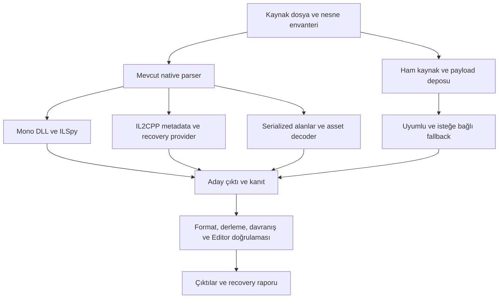

# AssetRipper — Decompile ve Rekonstrüksiyon Kalitesini Artırma Planı

Tarih: 19 Ekim 2026. İncelenen checkout: `beeb50ee1c223e856c860caa338e5309404956a3`.

Girdi: `/home/lykia/Downloads/assetripper_ultimate_gelistirme_plani.md` ve mevcut kaynak kodu. Bu belge, geniş ürün vizyonunu **daha fazla gerçek veri, daha doğru C# ve Unity'de doğrulanmış proje** üreten bir uygulama sırasına indirger. Buradaki yeni API, çıktı ve komut önerileri henüz uygulanmış özellikler değildir.

## 1. Ana karar ve başarı tanımı

**İlk yatırım sırası: corpus ve doğru raporlama → ham veriyi koruma → Mono decompile → MonoBehaviour şemaları → IL2CPP metot kurtarma → Unity proje bütünlüğü.** Shader, rig ve ses iyileştirmeleri bu çekirdeğin kanıtlarıyla ilerler; ECS/VFX araştırmaları ayrı kabul kapıları taşır.

“Daha iyi decompile” dört ayrı sonuçla ölçülecek:

| Sonuç | Kanıt | Tek başına yeterli olmayan gösterge |
|---|---|---|
| Veri kurtarma | Kaynak nesne, alan ve harici payload korunmuş | Daha çok dosya üretilmesi |
| C# üretimi | Kaynak parse edilir; hedef Unity referanslarıyla derlenir | Boş metotlu projenin derlenmesi |
| Davranış kurtarma | Bilinen örneklerde girdiler, çıktılar ve yan etkiler eşleşir | Decompiler'ın exception atmaması |
| Unity rekonstrüksiyonu | Script bağları, serialized alanlar, sahne/prefab ve import doğrulanır | Editor işleminin yalnızca sıfır kodla çıkması |

Her çıktı için `Raw`, `Decoded`, `Reconstructed`, `Placeholder` ayrımı tutulacak. Abstract/extern metotlar “başarısız gövde” sayılmayacak. Başarısız bir metodu `return default` ile değiştirip kurtarılmış saymak kabul edilmeyecek.

## 2. Kaynak kodundan doğrulanan durum ve ana plandaki düzeltmeler

Bağlantılar bu checkout'taki kaynaklara gider; gözlemler statik incelemeye dayanır.

| Bulgular | Teknik sonuç / plan değişikliği |
|---|---|
| [.NET ayarları](../Source/Directory.Build.props): `net10.0`, `IsAotCompatible=true` | Uygulamanın derleyicisi ile çıkarılan Unity projesinin C#/.NET hedefi ayrı tutulmalı. |
| [Import bağımlılıkları](../Source/AssetRipper.Import/AssetRipper.Import.csproj): `AssetRipper.Cpp2IL.Core=1.0.9`; [Export bağımlılıkları](../Source/AssetRipper.Export/AssetRipper.Export.csproj): `AssetRipper.ICSharpCode.Decompiler=11.1.0.9736` | Yeni bir Cpp2IL/ILSpy hattı kurmak yerine mevcut entegrasyonu ölçüp geliştirmek gerekir. Paket sürümünü değiştirmek ayrı, corpus ile doğrulanan PR olmalı. |
| [ScriptContentLevel](../Source/AssetRipper.Import/Configuration/ScriptContentLevel.cs): Level2, Mono'da dolu; IL2CPP'de boş metot hedefliyor | Varsayılan IL2CPP C# dosya sayısı davranış kurtarma ölçüsü değildir. |
| [IL2CppManager](../Source/AssetRipper.Import/Structure/Assembly/Managers/IL2CppManager.cs): Level3 için `RecoveryProcessingLayers` / `RecoveryOutputFormat`, yoksa varsayılanlar | Bu checkout'ta hook'lara atama bulunmadı. Level3 seçimini gerçek recovery yeteneği olarak raporlamadan önce kullanılan provider doğrulanmalı. Başka dağıtımlarda provider bulunmadığı sonucu çıkarılamaz. |
| [ScriptDecompiler](../Source/AssetRipper.Export.UnityProjects/Scripts/ScriptDecompiler.cs): bütün assembly decompile hatası yakalanıp yalnızca loglanıyor | Çağırana yapılandırılmış başarı/kısmi başarı/başarısızlık sonucu dönmeli. |
| [ScriptExportCollection](../Source/AssetRipper.Export.UnityProjects/Scripts/ScriptExportCollection.cs): eksik dosya `EmptyScript` ile tamamlanabiliyor ve export `true` dönebiliyor | Placeholder üretimi görünür olmalı; kısmi script başarısızlığı job sonucuna taşınmalı. |
| [Primary-content script export](../Source/AssetRipper.Export.PrimaryContent/Scripts/ScriptExportCollection.cs): ayrı ILSpy yolu da assembly exception'ını loglayıp devam ediyor, sonunda `true` dönebiliyor | Sonuç sözleşmesi iki export yoluna da uygulanmalı; birini düzeltmek yeterli değil. |
| [ILSpyAssemblyResolver](../Source/AssetRipper.Export/Scripts/ILSpyAssemblyResolver.cs): simple name ile ilk assembly seçiliyor | Aynı isimli farklı sürüm/kimlikler için belirsizlik raporu ve deterministik çözümleme gerekli. |
| [PlatformGameStructure](../Source/AssetRipper.Import/Platforms/PlatformGameStructure.cs) dosya adına göre assembly topluyor; [BaseManager](../Source/AssetRipper.Import/Structure/Assembly/Managers/BaseManager.cs) string anahtarla saklıyor | Çakışan adaylar resolver'dan önce elenebiliyor. Kimlik düzeltmesi discovery/manager/cache katmanlarını da kapsamalı. |
| [MonoManager](../Source/AssetRipper.Import/Structure/Assembly/Managers/MonoManager.cs): mscorlib yoksa Net100 referansından sentetik mscorlib oluşturuyor | Bu fallback'in varlığı ve kaynak farkı raporlanmalı; Unity uyumlu referans doğrulamasının yerine geçmemeli. |
| [GameAssetFactory](../Source/AssetRipper.Import/AssetCreation/GameAssetFactory.cs), [RawDataObject](../Source/AssetRipper.Import/AssetCreation/RawDataObject.cs): `UnknownObject`, `UnreadableObject`, TPK fallback mevcut | “Bilinmeyen veri hiç korunmuyor” genellemesi yanlış. Mevcut ham temsilleri ve exporter'ları genişlet; aynı veriyi ikinci bir nesne ağacına kopyalama. |
| [ExportSettings](../Source/AssetRipper.Export/Configuration/ExportSettings.cs): `ExportUnreadableAssets=false`; [exporter kaydı](../Source/AssetRipper.Export.UnityProjects/ProjectExporter.Overrides.cs) bu ayara bağlı | Bellekte ham veri bulunması, onun diske korunduğu anlamına gelmiyor. Recovery modu bu farkı raporlamalı. |
| [SerializedAssetCollection](../Source/AssetRipper.Assets/Collections/SerializedAssetCollection.cs): nullable factory sonucu eklenmeyebilir | Null hook'u gerekli bir sözleşme testi; üretim factory'si için tek ve en büyük veri kaybı nedeni olduğu henüz kanıtlanmış değil. |
| [GameAssetFactory](../Source/AssetRipper.Import/AssetCreation/GameAssetFactory.cs) / [UnloadedStructure](../Source/AssetRipper.Import/Structure/Assembly/Serializable/UnloadedStructure.cs): MonoBehaviour yapı okuması başarısızsa `Structure=null`; dependency yürüyüşü boş dönebiliyor | Kısmen okunmuş MonoBehaviour, tam kurtarılmış sanılmamalı. Payload ve eksik dependency bilgisi işlem öncesinde korunmalı. |
| [ObjectInfo](../Source/AssetRipper.IO.Files/SerializedFiles/Parser/ObjectInfo.cs): `ReadBytes(byteSize)`; byte offset yerel değişkende | Bellek refactor'undan önce kalıcı kaynak konumu eklenmeli. `ObjectData` tek başına kaynak offset'i sağlamıyor. |
| [BundleFileBlockReader](../Source/AssetRipper.IO.Files/BundleFiles/FileStream/BundleFileBlockReader.cs): partial stream, ArrayPool, blok cache ve büyük veride temp dosya mevcut | “Tüm bundle her zaman RAM'e yükleniyor” doğru bir baseline değil. Kalan kopyalar, nesne dizileri ve LZ4 yolu profillenmeli. |
| [GLB üretimi](../Source/AssetRipper.Export.Modules.Models/GlbLevelBuilder.cs), [Babylon önizleme](../Source/AssetRipper.GUI.Web/StaticContent/js/mesh_preview.js), [Fmod5Sharp](../Source/AssetRipper.Export.Modules.Audio/AssetRipper.Export.Modules.Audio.csproj) mevcut | 3D viewport, glTF/GLB ve ses decode sıfırdan başlamayacak; rig/animasyon ve harici bank/event eksikleri hedeflenecek. |
| [Shader exporter seçimi](../Source/AssetRipper.Export.UnityProjects/ProjectExporter.Overrides.cs): Simple/YAML/Dummy; bu checkout'ta `AssetRipper.Export.Modules.Shaders` projesi yok | “Decompile” enum değeri tek başına bu kaynakta bytecode decompiler bulunduğunu kanıtlamıyor. Bağımsız açık kaynak shader adaptörü ayrı iş. |
| [FormatVersion](../Source/AssetRipper.IO.Files/SerializedFiles/FormatVersion.cs) 22'ye kadar adlandırılmış; [SourceGenerated](../Source/AssetRipper.SourceGenerated.Extensions/AssetRipper.SourceGenerated.Extensions.csproj) NuGet bağımlılığı | Unity 6, SerializedFile sürümü, Entities paket sürümü ve üretilmiş sınıf şemaları ayrı uyumluluk boyutlarıdır. Enum'a 23 eklemek destek kanıtı değildir. |

## 3. Minimum mimari: önce birkaç sınır, sonra gerekirse yeni projeler

Başlangıçta mevcut Import/Processing/Export sınırlarını koru. Bağımlılıklar gerektirirse tek küçük `AssetRipper.Recovery` sözleşme projesi ekle; ana plandaki onlarca yeni `.csproj` ile başlama. IO ve Assets katmanlarına Export/GUI bağımlılığı ekleme.

### Kimlikler, kaynak konumu ve durum

- `InputId`: kaynağın SHA-256'sı. `AssetKey`: kaynak + bundle içindeki normalize entry kimliği + serialized collection kimliği + PathID + gerekiyorsa object ordinal. ClassID ayrıca tutulur; PathID tek başına küresel anahtar değildir.
- `MethodKey`: özgün assembly hash'i + module MVID + metadata token; IL2CPP'de metadata image/type/method index ve imza. Native eşleştirme ayrıca binary hash, RVA ve mimari taşır. ASLR adresi kimlik olarak kullanılmaz.
- Çapraz güncelleme diff'i için ayrı `LogicalMatchKey`/eşleştirme kanıtı kullan. Kaynak hash'i değişince tüm `AssetKey`'lerin değişmesi, tüm asset'lerin değiştiği anlamına gelmez.
- Kaynak referansı: dış dosya, bundle entry, `offsetSpace`, offset, length, endian, serialized format ve Unity version. Sıkıştırılmış bundle offset'i ile açılmış serialized stream offset'i karıştırılmaz.
- `RawState`, `ParseState`, `ExportState`, `ValidationState` ayrı alanlardır. `SkippedByPolicy`, `MissingDependency`, `Unsupported`, `Partial`, `Cancelled` nedenleri açık kalır.
- `MethodBodyOrigin`: `OriginalManagedIL`, `RecoveredNative`, `GeneratedStub`, `NoBodyByDesign`, `Unknown`. Buna bağımsız `ParsePassed`, `CompilePassed`, `BehaviorChecked/Passed` kanıtları bağlanır. Recovery provider'ın çıkış kodu bunların yerine geçmez.
- Her dönüşüm kaynak hash'ini, provider/sürümünü, ayar fingerprint'ini, isim eşleme kaydını ve çıktı hash'ini taşır. Başarısız deneme de kayıtlıdır.

### Ham veri ve işlem yaşam döngüsü

1. Envanter, factory okumasından ve mutation yapan processor'lardan önce oluşturulur. Mono DLL, IL2CPP binary/metadata ve serialized payload özgün halleriyle ilişkilendirilir.
2. `IRawObjectSink`/benzeri hook bağımlılığı ters çevirir; default no-op olabilir. Mevcut `RawDataObject` bu depoya bağlanabilir; çift byte dizisi ve çift disk kopyası zorunlu değildir.
3. `OnFailure` ve `AllReadable` koruma politikaları ayrılır. `OnFailure` için karar verilene kadar kaynak slice/lease geçerli kalır; erken dispose edilmez.
4. `.resS`, `.resource`, StreamingAssets/bank payload'ları ayrı `InputArtifact` olur. Serialized object baytlarını saklamak dış texture/audio/mesh stream'ini saklamak değildir.
5. Kaynağı kopyalamadan referanslamak `ReferencedOnly` durumudur. Taşınabilir arşiv `Preserved` sayılması için gerekli baytlar gerçekten job deposunda bulunmalıdır. Hash'ler yazarken hesaplanır; tüm oyunu gereksiz yere iki kez okumak hedeflenmez.
6. Milyonlarca asset için dev bir in-memory JSON listesi yerine append-only olay günlüğü + disk indeksi kullan. İlk küçük sürüm JSONL ile başlayabilir. Nihai manifest akışla üretilir; yarım son kayıt restart'ta ayıklanır.
7. Disk dolması ve iptal item decode hatası gibi yutulmaz. Journal/koruma yazılamıyorsa kontrollü dur; bilinen son durumu best-effort kaydet. İptal, OOM ve paylaşılan graph bozulması için “her exception'dan sonra devam” politikası uygulanmaz.

## 4. Fazlar ve geçiş kapıları

Eforlar planlama tahminidir; bir işi bilen geliştiricinin aktif mühendislik süresini ifade eder. Fixture/Editor erişimi ve upstream beklemesi dahil değildir. Araştırma başarısı için takvim garantisi verilmez. Özellikle Mono, IL2CPP ve shader işleri ayrı yetenekler gerektirir.

| Faz | İş ve somut teslim | Bağımlılık | İlk efor aralığı | Geçiş kapısı |
|---|---|---|---|---|
| F0 | Commit/bağımlılık kaydı, küçük corpus, baseline raporu, başarısızlık kategorileri | Yok | 2–4 gün | Aynı girdiler yeniden çalıştırılabilir; bilinmeyenler açıkça işaretli |
| F1 | Güvenli output, sonuç propagasyonu, raw/manifest, per-collection hata izolasyonu | F0 | 1–2 hafta | Okunabilir corpus baytları korunur; placeholder başarı sayılmaz |
| F2 | Mono resolver, hata izolasyonu, repair izleri, derleme ve davranış testleri | F1 | 2–3 hafta | Desteklenen Mono fixture'larında sıfır yeni derleme/davranış regresyonu |
| F3 | MonoBehaviour şema ve alan doğrulama; Unity 6 parser dilimi | F1 | 2–3 hafta | Alan değerleri ve PPtr'lar referans raporla eşleşir; belirsiz şema yayınlanmaz |
| F4a | Mevcut Cpp2IL fork/provider yetenek deneyi ve devam/durdurma kararı | F0, F1 | 3–5 gün | En az bir basit metotta gerçek gövde + davranış kanıtı veya açık “yalnız metadata” sonucu |
| F4b | Kanıtlanan provider için izole IL2CPP recovery entegrasyonu | F2, F3, F4a başarılı | 2–4 hafta | İlk seçili mimaride recovery/stub ayrımı ve bilinen davranış testleri geçer |
| F5 | Paket/script/reference bütünlüğü; seçici export | F2, F3; IL2CPP kapsamı için F4b | 1–2 hafta | Seçili fixture sahnesi/prefabı Editor'de eksik script/ref olmadan açılır |
| F6 | Hedefli fallback, rig, ses ve shader kalite dilimleri | F1; ilgili F3/F5 kapıları | Her dikey için ayrı tahmin | Aşağıdaki format kabul testleri; native yola göre ölçülmüş ek kazanım |
| F7 | Lazy object source, byte bütçesi, cache/checkpoint ve kontrollü paralellik | F1, baseline; export paralelliği için determinism | 2–4 hafta | Aynı doğruluk; ölçülen RSS/throughput hedefleri ve restart testleri |
| F8 | Entities/VFX ve oyun özel format araştırması; rapor/önizleme/diff genişlemesi | İlgili format fixture'ı ve F1 | Araştırma dilimleri | Her destek iddiası sürüm ve fixture ile sınırlı |

F4a erken yapılabilir; bağımsız native decompiler yazımı F4b tahminine dahil değildir. Provider yeterli değilse veri/Mono/şema iyileştirmeleri devam eder, native recovery ayrı araştırma backlog'una geçer. Her mimariyi aynı anda hedeflemek yerine corpus'ta bulunan Windows x64 veya Android ARM64 diliminden başlanır.

### F0 — Baseline ve test üretimi

- Repodaki mevcut build/test iş akışını çalıştır; SDK, paketler ve hata listesini kaydet. Sonuçları varsayma.
- [SystemTester](../Source/AssetRipper.Tools.SystemTester/Program.cs)'ı tekrarlanabilir sonuç JSON'u ve anlamlı exit code üretecek hale getir. Mevcut “istisna atmadı” sayacı yeterli değil. Test output temizliğini yalnızca job'a ait fixture dizinine sınırla.
- Aynı küçük projenin Mono ve IL2CPP build'ini oluştur. Özgün kaynak ve Editor'den alınmış alan/ref/transform raporu oracle olsun.
- İlk dilimler: Unity 2022 LTS Mono/IL2CPP + bir tam sürümü sabitlenmiş Unity 6 klasik proje. Ardından 2019 LTS ve eski sürüm regresyonları. Unity 4.x–6 × tüm platformlar tam çarpımı ilk PR kapısı değildir.
- Başarısızlıkları say: parser/layout, missing assembly, decompiler, generated stub, missing external stream, shader, invalid mesh, missing reference. İlk sonraki işler ölçülen kayba göre sıralanır.

### F1 — Sonuçları doğru raporlayan kurtarma çekirdeği

- `ScriptDecompiler.DecompileWholeProject` yapılandırılmış sonuç döndürür: beklenen/üretilen tipler, başarısız tip/metotlar, diagnostics, placeholder ve çıktı listesi.
- `ScriptExportCollection` bu sonucu toplar; `EmptyScript` dosyalarını açık placeholder olarak kaydeder. `bool` sözleşmeleri korunacaksa yan sonuç agregatörü eklenir; bunlar “tam başarı” anlamına gelmez.
- Primary-content script exporter aynı sonuç sözleşmesini kullanır. Ortak decompile hizmeti `Export` katmanında olabilir; UnityProjects'a özgü `.meta`/dosya politikası ile primary-content `.csproj`/solution üretimi kendi katmanında kalır.
- Hem `PrimaryContentExporter` hem `ProjectExporter` için collection oluşturma ve export hatalarını ayrı yakala. Bağımsız sonraki koleksiyon devam eder; bozulan koleksiyona bağımlı çıktılar `MissingDependency/BlockedByFailure` olur.
- Raw hook'u null, `UnknownObject`, `UnreadableObject` ve kısmi MonoBehaviour yollarını kapsar. File-level parse hatası ile nesne-level hata ayrılır; parse edilemeyen dosyanın object sayısı uydurulmaz.
- `GameFileLoader` GUI/headless akışlarında mevcut dolu hedef yerine yeni job dizini oluşturur. Silme davranışının değişmesi ayrı, görünür bir uyumluluk değişikliğidir.
- Normal primary-content handler öncelikleri korunur: bazı boş handler'ların üstüne model exporter kaydı geliyor. “RegisterEmptyHandler varsa kesin kayıp” varsayımı yerine fiilen seçilen handler/owner kaydedilir.

Kabul: Null factory, unknown class, unreadable nesne, kısmi MonoBehaviour, tek bozuk collection ve decompile exception fixture'larının her birinde doğru durum; erişilebilir raw hash eşitliği; mevcut hedef dosyalar korunmuş. İptal ve disk hataları için ayrı job sonucu var.

### F2 — Mono C# kalitesini doğrudan yükseltme

1. **Referans çözümleme:** assembly name/version/culture/public-key-token ile adayları indeksle; modül ve type forwarder bağlarını kaydet. Önce discovery'de aynı dosya adlı adayların korunmasını sağla; `BaseManager`, stream/type cache ve resolver kimliklerini birlikte ele al. Tam eşleşme yoksa kontrollü fallback + diagnostic. Rastgele ilk DLL seçme; oyun referanslarını host `.NET 10` assembly'leriyle gelişigüzel doldurma.
2. **Hedef profil:** Unity sürümü, API compatibility, dil sürümü ve paket referanslarını ayrı profile bağla. Mevcut `ScriptLanguageVersion` otomatik eşlemesini iki export yolunda da fixture ile denetle; primary-content yolundaki sürümsüz auto dönüşümü `Latest` seçebiliyor. `MonoManager` sentetik mscorlib fallback'i provenance taşır ve uyumlu referanslarla ayrıca kontrol edilir. Unity 6.0 belgesi C# 9 ve bazı özellik kısıtları belirtir; host SDK bunu değiştirmez. [Unity derleyici belgesi](https://docs.unity3d.com/6000.0/Documentation/Manual/csharp-compiler.html).
3. **Hata izolasyonu:** normal whole-project yolu hızlı kalır. Başarısız assembly için önce type düzeyinde tekrar dene; gerekirse üyeyi tanılayan yol ekle. Kullanılan ILSpy API'siyle partial/nested tip, dosya adı ve `.meta` eşleşmesinin korunabildiği prototipte gösterilmeden yöntemi sabitleme.
4. **Repair izleri:** [mevcut processor'lar](../Source/AssetRipper.Export.UnityProjects/ExportHandler.cs) korunur; her isim/attribute/body değişikliği token tabanlı günlüğe yazılır. Özgün DLL ve işlenmiş DLL ayrı kimlik taşır. ObfuscationRepair “yeniden yazalım” işi değildir.
5. **İsim güvenliği:** identifier düzeltmesinde assembly/type/member çakışmaları deterministik çözülür. Serialized alan adı, `SerializeReference` tip adı, UnityEvent target method ve string tabanlı kullanım etkileri kontrol edilir. Kanıtsız rename runtime string'lerine otomatik uygulanmaz.
6. **Doğrulama:** C# parse → hedef referanslarla compile → API/serialized field karşılaştırma → bilinen davranış fixture'ları. Async/iterator, generics, explicit interface, events/properties, ref/out, exceptions ve Unicode isimleri kapsa.

Kabul: Bir tip başarısızsa bağımsız tipler üretilir; stub sayısı açık kalır; desteklenen fixture'ların özgün davranış sonuçları değişmez. Yeniden derlenen IL'nin byte hash eşitliği beklenmez; semantik ve metadata sözleşmeleri kontrol edilir.

### F3 — MonoBehaviour, TypeTree ve Unity 6 format doğruluğu

Şema seçimi nesnenin türüne göre ilerler:

- **MonoBehaviour:** kaynak TypeTree → özgün Mono DLL veya IL2CPP metadata'dan Unity serialization kurallarıyla türetilen alan şeması → yalnızca doğrulanmış eşleşen schema cache → ham payload.
- **Engine class:** mevcut generated reader ve sürüm/platform profili → mevcut TPK/uyumlu TypeTree yolu → testlenmiş alternatif parser veya ham payload. Kullanıcı script alanları ClassID=114 ve Unity sürümünden tek başına çıkarılamaz.
- `SerializeReference`, inheritance, private `[SerializeField]`, generic alanlar, nested arrays/list, alignment, endian ve referenced types için karşılaştırmalı fixtures ekle. Native C++ field offset'i, serialized dosyadaki alan offset'i değildir.
- Okuma uzunluğu, padding kuralı, array bounds, alan değerleri ve PPtr çözümü birlikte doğrulanır. Tam byte tüketimi gerekli bir kanıt olabilir; tek başına doğru şema garantisi değildir.
- Başarısız `Structure` okumasından sonra tail/payload korunur. Bilinmeyen alanlar için boş değer veya tahmini alan adı gerçek veri diye yazılmaz. Dependency listesi bu durumda `Incomplete` işaretlenir.
- Unity 6 için önce gerçekten hata veren tam sürüm/format fixture'ı üret. Header/metadata/type tree değişikliklerini ayrı test et; `AssetRipper.SourceGenerated`/TPK değişikliği gerekiyorsa o paketteki üretim ve güncelleme işi ayrı takip edilir.

Kabul: Aynı nesnenin kaynak Editor raporundaki alan değerleri, managed reference kimlikleri ve PPtr hedefleri eşleşir. Yanlış sürüm şeması “başarılı” seçilmez. SerializedFile 23 için eski 22 corpus'u da geçer; yalnız enum genişletmesi kabul edilmez.

### F4 — IL2CPP: metadata ile gerçek metot gövdesini ayırma

**F4a deneyinde cevaplanacak sorular:** Pinli `AssetRipper.Cpp2IL.Core` ne üretiyor? Kullandığı fork ile upstream hangi mimari/metadata sürümlerinde gerçek gövde üretebiliyor? Recovery provider hangi assembly ve processing layer'ları gerektiriyor? Aynı örnekte stub ile recovered body nasıl ayırt ediliyor?

Cpp2IL upstream, gelişmekte olan bir recovery hattı ve sürüme bağlı processing/output seçenekleri tanımlıyor. Oradaki CLI adları mevcut pinli NuGet API'sinde aynı yeteneğin bulunduğunu kanıtlamaz. Fork/paket commit'i ve gerçek örnek çıktı incelenerek karar verilir. [Upstream](https://github.com/SamboyCoding/Cpp2IL), [AssetRipper fork'u](https://github.com/AssetRipper/Cpp2IL).

1. Binary + `global-metadata.dat` + Unity sürümü + mimari eşlemesini yapısal kontrollerle doğrula. Yanlış binary/metadata çifti recovery denemesinden önce reddedilir; magic/version tek başına yeterli değildir.
2. Assembly/type/field/method imzaları ve native address eşlemesini üret; bu metadata teslimi metot recovery'den bağımsız faydalıdır.
3. İlk hedefte aritmetik, branch/loop, field load/store, doğrudan çağrı, basit virtual çağrı ve string/constant örneklerini sırayla dene. Her örnekte özgün kaynakla davranış oracle'ı karşılaştır.
4. Provider uygunsa mevcut Level3 hook'una açık capability kaydı ekle. Provider yoksa `RecoveryUnavailable` raporla; Level2 çıktısını sessizce Level3 başarısı sayma.
5. Provider/global Cpp2IL state'i nedeniyle başlangıçta bir iş bir helper süreçte çalışır. İşler arasında reset/dispose ve crash izolasyonu doğrulanmadan aynı süreçte paralel analiz açılmaz.
6. Zor örnekler ikinci dilimdir: generic sharing, value type/boxing, interface dispatch, exceptions, inlining/stripping ve platform ABI. Paylaşılan native gövde tek bir özgün generic metoda zorla eşlenmez.
7. Başarısız recovery'de imza + açık stub + native disassembly/IR sidecar'ı uygun olduğunda tutulur. Pseudocode ile derlenebilir C# ayrı varyanttır; makine kodu uzunluğu yalnızca sonraki fonksiyona kadar varsayılmaz.

Kabul: `RecoveredNative` yalnız provider kanıtı ve yapı doğrulaması olan metotlara atanır; `BehaviorPassed` yalnız test edilenlerde bulunur. Ortak generic adresler, abstract/extern ve generated stub sayaçları ayrı raporlanır. Kaynaktan silinmiş metot/isimler için %100 geri dönüş hedefi konmaz.

**Araştırma kararı:** F4a gerçek gövde sağlayamıyorsa adapter yazmak sorunu çözmez. Yeni native analiz/IR/CIL üretimi ayrı kapsam, efor ve corpus gerektirir; sırf arayüzü tamamlamak için recovery yapılmış gösterilmez.

### F5 — Unity projesi ve seçici export

- Scene → GameObject/component → MonoScript → assembly/type → serialized field → PPtr zinciri için doğrulama raporu üret.
- `.meta` GUID/fileID, aynı ada sahip script'ler, nested/generic tipler, assembly definitions ve paket referanslarını kontrol et. Bilinen özgün GUID korunur; üretilmiş GUID ayrı köken taşır.
- [PackageManifestPostExporter](../Source/AssetRipper.Export.UnityProjects/Project/PackageManifestPostExporter.cs)'ın sürüme göre varsayılan paket üretimi ile gerçek ihtiyaçları karşılaştır. Paket sürümünü kanıtsız tahmin edip özgün sürüm gibi sunma; kanıt yoksa unresolved gereksinim raporla.
- Seçici export için önce class/name/PathID predicate yeterlidir; tam arama motoru bağımlılığı yaratma. Asset seçimi export collection sahipliğine yükseltilir; prefab/sahne üyeleri ve atomik gruplar parçalanmaz.
- İleri referans closure'ı visited set ile hesapla; döngüleri destekle. Bilinmeyen MonoBehaviour alanları varsa closure `Incomplete` olur. Bilinen bağımlılıkların dahil edilmesi, tüm bağımlılıkların bulunmuş olduğu iddiası değildir.
- Editor kontrolü: import diagnostics, compiler diagnostics, missing scripts, unresolved GUID/fileID, sahne/prefab yükleme ve beklenen alan değerleri. Ayrı bir raporlayıcı test harness'i kullan; yalnız exit code'a bakma.

Kabul: Küçük referans sahnesinde beklenen script ve alan bağları korunur; subset export'ta ilgisiz varlıklar çıkmaz, gerekli bilinen bağımlılıklar çıkar. Kaynağı gerçekten eksik bağımlılık açık nedeni ile rapordadır.

## 5. Format işleri: her biri bağımsız ve doğrulanabilir teslim

### Shader ve materyal

1. Mevcut Simple/YAML/Dummy yollarını baseline al. Material properties, texture bağlantıları, keywords, pass/subprogram ve bytecode'u kaynak konumuyla sakla.
2. Container tanıma, Unity program wrapper'ını açma ve bytecode dönüştürmeyi ayrı aşamalara böl. SMOL-V varsa ilgili çözme aşaması tespit edilir; ham container doğrudan SPIRV-Cross'a verilmez.
3. İlk dikey: SPIR-V reflection → kaynak binding eşlemesi → desteklenen HLSL/GLSL çıktısı → uygun validator/compiler. SPIRV-Cross SPIR-V üzerinde çalışır; DXBC/DXIL için ayrı adapter ve corpus gerekir. [SPIRV-Cross](https://github.com/KhronosGroup/SPIRV-Cross).
4. ShaderLab wrapper'a render state, pass/stage, buffer layout ve keyword varyantlarını kontrollü eşle. URP/HDRP template'i “yaklaşık materyal” olarak işaretle; derlenmesi görsel eşdeğerlik kanıtı değildir.
5. DXBC, DXIL ve Metal için önce tespit + bytecode/reflection teslimi; tam dönüşüm yalnız araç/sürüm ve örnek kanıtından sonra. Kaybolmuş ShaderGraph düğümleri geri gelmiş gibi üretilmez.

Kabul: Kaynak bytecode korunur; reflection binding'leri beklenen fixture ile eşleşir; desteklenen varyant yeniden derlenir ve kontrollü sahnede görüntü farkı toleransı sağlanır. Template, decompiled kaynak sayılmaz.

### Mesh, animasyon, Humanoid Avatar

- Mevcut GLB/SharpGLTF hattında skeleton parent, bindpose, bone weights, coordinate conversion, negative scale, blendshape ve clip binding raporu çıkar.
- NaN/Infinity gibi geçersiz transform durumunda asset'i gerekçeli başarısız say; kaynak değerleri sessizce sıfırlama. İsteğe bağlı repair ayrı varyant ve değişiklik günlüğü taşır.
- Generic skeletal animasyon ve Humanoid muscle/retargeting ayrı işlerdir. Humanoid için Avatar/T-pose/human bone mapping ve root motion kanıtı istenir.
- FBX için ilk aşamada seçilen mevcut exporter/opsiyonel Blender dönüşümü incelenir; yeni SDK bağımlılığı ancak hedef kalite ve dağıtım kararı netleşince eklenir.

Kabul: GLB validator, beklenen vertex/index/bone sayısı; belirli zaman örneklerinde bone world matrix ve skinned vertex konumları tolerans içinde. Blender import etmesi tek başına deformasyon doğruluğu kanıtı değildir.

### FMOD / Wwise

- Mevcut AudioClip/Fmod5Sharp kapsamını koru; harici `.bank`, `.bnk`, `.pck`, `.wem` container, stream ve event metadata katmanlarını ayır.
- İlk teslim: bank envanteri + raw media → desteklenen vgmstream decode → kanal/sample rate/frame count/loop bilgisi doğrulaması. FFmpeg yalnız uyumlu medya formatlarında opsiyonel dönüşüm sağlar.
- Event ID → media ID ilişkisini parser'ın gerçekten okuduğu bank yapısından çıkar. İsim tablosu yoksa sayısal kimlikler korunur; event isimleri tahmin edilmez. Wwise/FMOD sürüm dilimleri ayrı corpus taşır.

Kabul: Bilinen PCM fixture'ında örnek/frame sayısı ve loop aralıkları eşleşir; event bağlantıları referans raporla aynı. “Ses decode edildi” ve “event haritası kurtarıldı” ayrı durumdur.

### DOTS / ECS ve VFX

- Önce tam Entities paket sürümü ve build hedefi sabitlenmiş kendi fixture'ımız: section/entity/component/blob referans envanteri; sonra bilinen transform/parent/render bileşenleri için inceleme sahnesi.
- Entity kimliklerini klasik PathID sistemine zorla sokma; section/component kimlikleri ayrı alanlarda tutulur. Bilinmeyen component payload'ları korunur.
- Çıktı `ECSSceneReport` ve temsili sahnedir. Baking'in tersinir olmadığı Unity tarafından açıkça belirtilir; özgün authoring GameObject düzeni vaat edilmez. [Entities baking](https://docs.unity3d.com/Packages/com.unity.entities@1.3/manual/baking-overview.html).
- VFX için önce [mevcut kayıp notları](../Source/AssetRipper.Processing/Notes.md) ve kontrollü fixture karşılaştırılır. Parametre/resource/compute verisi teslimi ile özgün graph kurtarma ayrı hedeflerdir.

Kabul: Desteklenen sürümde entity/section ve bilinen component sayıları, transform ve referanslar Editor raporuyla eşleşir. Eksik authoring verisi açık kalır; bilinmeyen paket sürümü otomatik destekli sayılmaz.

### Önizleme, arama ve asset diff

- İlk UI teslimi manifestten raw/partial/stub/decode sonuçlarını, başarısızlık nedenini ve kullanılan provider'ı gösterir. Bir assembly'den ilgili MonoScript ve sahne kullanımına geçiş sağlanır.
- Mevcut Babylon viewport'a rig/bone, clip seçimi, UV/material bilgisi eklenir; GLB doğrulama sonuçları gösterilir. Büyük mesh/texture önizlemesi için decode ve GPU bütçesi uygulanır.
- Selective export predicate'i ile aynı asset kimliğini kullanan class/name/PathID/ref indeksinden başlanır. İleri sorgu dili ve büyük dependency grafiği sonra gelir.
- Diff, iki manifest snapshot'ını karşılaştırır: özgün kimlik varsa onu, yoksa logical key + içerik/semantik kanıtlarını kullanır. `Added`, `Removed`, `Modified`, `Unchanged`, `Uncertain` ayrılır; rename benzerliği kesin eşleşme sayılmaz.
- Kabul: Yeniden paketlenmiş ama içeriği aynı bundle sahte toplu değişiklik üretmez; bir alan/texture değişimi ilgili asset'e bağlanır. Belirsiz eşleşme kullanıcıya açık kalır.

## 6. Çoklu parser, plugin ve REA'nın doğru yeri

**Decompile MVP'si için iki alternatif parser entegrasyonunu zorunlu kapı yapma.** Önce native hatasını gösteren fixture ve alternatifin doğruladığı somut kazanım olsun. AssetsTools.NET/UnityPy aynı kaynağı başarıyla açabiliyorsa anlamlıdır; ikisi de bilinmeyen native metot gövdesini kendiliğinden geri getirmez.

- `Probe → Run → Validate → CommitCandidate`: her aday ayrı staging dizininde; timeout, cancellation, stdout/stderr sınırı ve process-tree cleanup. Çıkış kodu ve dosya varlığı başarı ölçüsü değildir.
- `Capability`: format/sürüm/platform, işlem türü ve çıktı şeması içerir. Native/alternatif parser anlaşmazlığı object count, type/layout ve değer kanıtlarıyla incelenir; çoğunluk oyu doğruluk sayılmaz.
- İlk adapter yalnız ölçülen sorunu çözer. Uyumsuz şemayı global graph'a hemen birleştirme; ID/ref remap, endian ve kaynak eşlemesi doğrulanmadan sidecar candidate olarak tut.
- Native AOT içinde runtime `Assembly.LoadFile` modeli desteklenmez. Statik kayıtlı core ve isteğe bağlı ayrı managed plugin host kullan; C# script/DLL extensibility o host'ta bulunabilir. [Microsoft Native AOT kısıtları](https://learn.microsoft.com/en-us/dotnet/core/deploying/native-aot/).
- Ayrı süreç tek başına sandbox değildir. Gerekli dosya/işlem/bellek sınırlarını OS mekanizmasıyla uygula; uygulanamayan sınırı raporla. İlk SDK tüm plugin türlerini değil, `IAssetFilterPlugin` ve bir özel reader/decode sözleşmesini kanıtlasın.
- Oyun özel metadata/bundle dönüşümü için format probe + kullanıcı tarafından sağlanan decoder/anahtar + post-decode yapısal validation yeterli sınırdır. Genel “her obfuscation/şifrelemeyi otomatik çözer” taahhüdü verme.
- REA, takılan somut native örnek için ayrı araştırma işi: örnek hash/sürüm → dosya yapısı/offset kanıtı → minimum fixture → parser kuralı → regresyon testi. Araç çıktısı ürün parser'ına kanıtsız kural olarak eklenmez. Bu plan hazırlanırken REA/native binary analizi veya Frida çalıştırılmadı; bağlı araçların varlığı doğrulanmış sayılmıyor.

## 7. Performans: doğruluktan sonra ölçülen darboğazı çözme

1. Baseline'da peak RSS, managed allocation/LOH, GC pause, decoded bytes, disk I/O, temp disk ve aşama sürelerini ayır. `dotnet` işlem belleği ile helper süreçlerin toplam belleği ayrı ölçülür.
2. `ObjectInfo` kaynak konumunu kalıcı hale getir; sonra `IRawObjectSource.OpenSlice`/benzeri lease tabanlı erişim tasarla. `byte[]` zorunlu reader'ları tek seferde kırmak yerine geçiş adaptörü kullan.
3. Mevcut SmartStream/temp-file/blok cache davranışını ölç. MMF yalnız sıkıştırılmamış veya açılmış veride uygun olduğunda kullanılır; dekompresyon ve texture decode maliyetini ortadan kaldırmaz.
4. İlk paralellik, bağımsız kaynak okuma ve izole decode işleridir. Paylaşılan mutable `GameBundle`, collection state, GUID/path üretimi ve `ProjectAssetContainer.CurrentCollection` thread-safe kabul edilmez.
5. Channel kapasitesini item sayısına ek **byte bütçesi** ile sınırla. Büyük tek iş için disk spill veya açık red politikası gerekir; bütçeden büyük nesne semaphore beklerken sonsuza kadar kilitlenmez. Native decoder iç tahsisleri için helper süreç limiti veya ölçülebilir ayrı bütçe gerekir.
6. Önce kimlik/path/dependency planı deterministik oluşturulur; bağımsız dönüşümler paralel, manifest/commit kontrollü yapılır. Dependency barrier ve lease yaşam süresi doğrulanır; ref-struct `Span` await sınırları boyunca taşınmaz.
7. Checkpoint işlemi ancak doğrulanmış çıktı + hash + commit kaydı sonrasında tamamlanmış sayılır. Crash'te yarım staging silinir/ayıklanır; multi-file collection atomik rename gibi varsayılmaz, commit receipt ile tamamlanır.
8. Cache anahtarı kaynak/object + dependency içerikleri + schema/decoder/provider sürümü + ilgili ayarlar/target profile taşır. Aynı kaynağın paket/şema bağı değişmişse cache geçersizleşir. GUID ve zaman alanları normalize edilerek determinism kontrol edilir.

Kabul: Seri ve paralel çıktıların semantik sonuçları aynı; kill/cancel/disk-full testleri yarım çıktıyı başarı saymaz. Küçük/orta/büyük corpus için RAM ve süre hedefleri F0 ölçümünden sonra sabitlenir. 30–80 GB girdi için örneğin “4 GB RAM kesin yeter” gibi ölçülmemiş garanti verilmez.

## 8. Corpus ve kalite kapıları

Fixture'lar küçük, kaynağı ve üretim sürümü belli olmalı. İlk sprint'te ürünün tüm özelliklerini taklit eden büyük bir test deposu yerine aşağıdaki hata sınıflarını gerçekten ayıran örnekler hazırlanır.

| Fixture grubu | Kontrol edilen durum | Oracle |
|---|---|---|
| Mono dil örnekleri | Generics, async/iterator, explicit interface, ref/out, exceptions, properties/events | Özgün kaynak + compile ve davranış sonuçları |
| Mono assembly çözümleme | Aynı simple name farklı kimlik, eksik ref, type forwarder | Beklenen resolver kararı/diagnostic |
| MonoBehaviour | Kalıtım, private SerializeField, managed references, arrays, endian/alignment | Editor alan/PPtr raporu |
| IL2CPP basit/zor metotlar | Gerçek gövde, stub, generic sharing, stripped method, yanlış metadata çifti | Kaynak + metadata/native eşleme + davranış |
| Unity klasik/Unity 6 | Serialized format, TypeTree açık/kapalı, generated schema | Sabit build ve beklenen parse raporu |
| Bozuk/kısmi girdi | Null factory, unreadable, truncated data, missing external stream | Raw hash ve beklenen failure code |
| Sahne/prefab/rig | GUID/fileID, script binding, transform, skinning, selected subset | Editor raporu ve zaman örnekleri |
| Shader/audio/ECS | Bytecode variant, bank/media/event, entity/component | İlgili kaynağın kontrollü üretim raporu |
| Job ve kaynak limiti | Cancellation, kill/restart, disk full, büyük tek item | Commit/journal ve tamamlama durumu |

Her fixture kaydı: source/build SHA-256, Unity tam sürümü, backend, mimari, platform, API profile, paket sürümleri, format/codec, beklenen destek alanı ve üretim/lisans bilgisi. Beklenen başarısızlıklar görünür kalır; testleri geçirmek için denominatörden silinmez.

CI katmanları:

- **Her PR:** mevcut .NET testleri + küçük parser/decompile fixtures + hedef referanslarla compile. Saf ve kontrolümüzdeki metot fixture'ları için davranış karşılaştırması. Adapter kullanan testler pinli ve ayrı etiketli.
- **İlgili format PR'ı / gece:** geniş corpus, OS matrisi, shader/GLB/audio validator ve cache/determinism. Tekrar test yalnız yeni değişiklik veya unresolved hata gerektiriyorsa yapılır.
- **Editor erişimli iş:** uygun tam Unity sürümüyle batchmode test harness'i; compile/import/scene/ref sonuç dosyası. Editor veya lisans yoksa `NotRun`, başarılı sayılmaz. Eski Unity/host uyumluluğu runner seçiminde açık tutulur.
- **Gece / yayın:** performans ve fault injection, decoder/parser sınırları için fuzz; AOT publish ve kullanılacak native bağımlılıklar için platform smoke.

Başarı metrikleri:

| Metrik | Pay / payda ve yorum |
|---|---|
| Inventory accounting | Sonuç kaydı olan nesne / başarıyla okunmuş object table nesnesi; hedef %100. Parse edilemeyen dosyalar ayrıca sayılır. |
| Raw preservation | Job deposunda doğrulanmış ham veri / politika kapsamında okunabilir ham veri; referenced-only ayrı sayılır. |
| Field recovery | Oracle'ı bulunan doğru alan değerleri / aynı fixture'daki beklenen alanlar; type ve sürüm bazında |
| Body recovery | Generated stub olmayan recovery gövdeleri / seçili dilimde gövde beklenen metotlar; doğruluk iddiasından ayrı |
| Compile success | Hedef profile derlenen çıktı grupları / denenmiş gruplar; placeholder miktarı yanında gösterilir. |
| Behavior agreement | Oracle testlerini geçen metotlar / gerçekten test edilen metotlar; test edilmeyenler ayrıca görünür. |
| Reference integrity | Doğru çözülmüş beklenen ref / oracle'daki ref; kaynağı eksik ve okunamayan alanlar ayrı |
| Fallback gain | Yalnız fallback sayesinde ek doğrulanan nesne/metot sayısı; toplam dosya artışı değil |
| Operasyon maliyeti | İş süresi, RSS, temp disk, output büyüklüğü, retry ve helper maliyeti; aynı donanım/girdiyle kıyas |

Sürüm kapısı: desteklenen fixture'larda yeni davranış/alan/ref kaybı sıfır; açıklanmayan envanter eksikliği sıfır; false-success örnekleri sıfır. “Tam oyun kurtarma yüzdesi” gibi farklı doğruluk katmanlarını tek sayıya karıştıran skor yayınlama.

## 9. İlk uygulanacak PR paketi

Her PR tek ana davranışı değiştirir, kendi kabul testi ve ilgili baseline karşılaştırmasını taşır. `S`: yaklaşık 1–2 gün; `M`: 3–5 gün; `L`: 1–2 hafta. Fikstür üretimi bazı işlerin ön koşuludur; süreler toplama yoluyla teslim garantisi oluşturmaz.

| ID | PR kapsamı ve mevcut dokunma noktası | Bağımlılık | Boyut | Kabul kanıtı |
|---|---|---|---|---|
| P01 | Baseline runner çıktısı ve 2–3 küçük decompile fixture'ı; SystemTester/CI | Yok | M | Tekrarlanabilir sonuç JSON'u, başarısızlıkta nonzero exit |
| P02 | Ortak decompile sonuç sözleşmesi; iki script export yolunda partial/placeholder kaydı | P01 | M | İki yolda decompile exception başarı sayılmaz; dummy açıkça işaretli |
| P03 | `GameFileLoader` ve SystemTester için job output politikası | P01 | S–M | Mevcut hedefteki kullanıcı dosyaları korunur |
| P04 | Per-collection creation/export hata izolasyonu ve sonuç agregasyonu | P01, P02 | M | Bir bozuk collection sonrası bağımsız collection çıkar |
| P05 | Raw provenance hook + journal; factory null/raw/kısmi MonoBehaviour yolları | P01 | L | İşlem öncesi baytlar korunur; hash, kaynak ve durum eşleşir |
| P06 | Discovery/manager/cache ve resolver boyunca assembly identity indeksi | P02 | M–L | Aynı dosya/simple name çakışması import'ta kaybolmaz; çözüm deterministik |
| P07 | Mono compile/behavior harness; hedef dil/API profile kontrolleri | P02, P06 | L | Bilinen dil örnekleri hedef referanslarla compile ve davranış testi geçer |
| P08 | Assembly → type fallback; başarısız üyeyi ilişkilendirme | P07 | L | Bir bozuk tip yüzünden bağımsız tipler kaybolmaz |
| P09 | MonoBehaviour payload/şema/ref doğrulaması; `UnloadedStructure` partial sonucu | P05, P07 | L | Alan/PPtr oracle eşitliği ve raw fallback |
| P10 | IL2CPP provider deneyi ve capability raporu; F4a | P01, P02 | M | Recovery veya metadata-only kararı gerçek fixture ile belgeli |
| P11 | Yeterli provider için izole recovery worker ve MethodBodyOrigin | P05, P07, P10 olumlu | L; kalan kapsam ayrıca tahmin | Stub/recovered ayrımı, yanlış metadata çifti ve davranış testleri |
| P12 | Unity 6/SerializedFile 23 gerçek repro ve parser/package değişikliği | P01, P05 | M–L; format kanıtına bağlı | Yeni fixture + eski format regresyonları |
| P13 | GUID/fileID/script/asmdef ve Editor validation dilimi | P07, P09 | L | Referans sahnede missing script/ref yok |
| P14 | Predicate tabanlı selective export ve collection/dependency closure | P09, P13 | L | Beklenen subset ve incomplete-dependency raporu |
| P15 | Tek kanıtlanmış hata için AssetsTools.NET **veya** UnityPy fallback | P05; uyumlu fixture | M–L | Native'a göre en az bir ek doğrulanmış sonuç; bozuk aday reddi |
| P16 | Object source lease + lazy read prototipi ve benchmark | P05, P01 | L | Kaynak ömrü doğru; allocation/RSS farkı ölçülü |

P10 ve P12, fixture sağlandığında erken yapılabilir. P11 başarısızsa P13/P14 Mono kapsamıyla devam eder; core geliştirme native araştırmasına kilitlenmez. Shader, audio ve rig işleri P15 benzeri **bir format/codec/sürüm dilimi** olarak ayrı PR serilerine bölünür.

İlk sprint önerisi: P01 + P02 + P03; kapasite kalırsa P04 ve P10 deneyi. Sonraki sprint: P05 + P06/P07. İlk çıktıda yeni UI veya çok sayıda adapter yerine yanlış başarı bildirimlerini kaldırmış, tekrar üretilebilir bir kalite raporu hedeflenir.

## 10. Upstream takibi ve açık kararlar

19 Ekim 2026 web kontrolünde [#2386](https://github.com/AssetRipper/AssetRipper/pull/2386), [#2249](https://github.com/AssetRipper/AssetRipper/pull/2249), [#2318](https://github.com/AssetRipper/AssetRipper/pull/2318) açık görünüyordu. Collection exception, paket/GUID ve split import işlerini uygulamadan önce diff'leri karşılaştır; aynı düzeltmeyi tekrar yazma. [SerializedFile 23 #2304](https://github.com/AssetRipper/AssetRipper/issues/2304) açık görünüyordu. [#2057](https://github.com/AssetRipper/AssetRipper/pull/2057) güncel durum kontrolü bu incelemede tamamlanamadı; GUID değişikliği öncesinde yeniden doğrulanmalı. Web durumu yerel checkout'a uygulanmış kod anlamına gelmez.

Başlangıçta kayda bağlanacak kararlar:

| Karar | Önerilen başlangıç | Kararı değiştirecek kanıt |
|---|---|---|
| İlk recovery hedefi | Corpus'ta elde bulunan tek x64 veya ARM64 dilimi | İkinci mimaride doğrulanmış gerçek kullanıcı kaybı |
| IL2CPP provider | Mevcut fork/pin + izole upstream karşılaştırması | F4a davranış/uyumluluk sonucu |
| Manifest deposu | JSONL journal + küçük disk indeksi | Ölçülen sorgu/ölçek ihtiyacı; gerekirse SQLite |
| Raw varsayılanı | Normal export korunur; recovery profilinde açık koruma politikası | Disk maliyeti ve kullanıcı ihtiyacı |
| Plugin modeli | Statik core + opsiyonel managed worker | AOT/platform paket smoke sonuçları |
| Bytecode önceliği | Fixture varsa önce SPIR-V; diğerleri ayrı araştırma | Desteklenen hedef oyunlardaki ölçülen shader kaybı |
| Ürün genişlemeleri | Önce mevcut Babylon preview ve sonuç raporu | Core kalitesi doğrulanınca diff/ileri arama |

FUSE, genel job server, AI Copilot, yeni 3D motoru ve çok sayıda exporter decompile MVP'sinin bağımlılığı yapılmaz. Bunlar ana planda korunabilir, ancak ilk kalite kazanımını geciktirmemelidir.

## 11. Bu incelemede yapılan doğrulama

- Verilen Markdown planı ile mevcut import, assembly processing, decompile, export, raw, IO ve preview yolları karşılaştırıldı.
- Checkout SHA'sı ve yerel `.NET SDK 10.0.113` doğrulandı; ilgili upstream ve resmi format/runtime belgeleri incelendi.
- Planın ilk yazımında build, test, Unity Editor import, performans benchmark'ı ve gerçek IL2CPP recovery deneyi çalıştırılmamıştı. Sonraki uygulama sonuçları aşağıdaki kayıtta ayrıca tutuluyor.

## 12. İlk uygulama paketinin durumu

- P01: SystemTester JSON/exit-code altyapısı ve kaynak sahibi olduğumuz managed/serialized test örnekleri eklendi. Editor'den üretilmiş Mono/IL2CPP corpus dilimi açık.
- P02: İki script export yolunda ortak sonuç/diagnostic raporu, ILSpy `Errors` kontrolü, placeholder kaydı ve üst export sonucuna hata aktarımı uygulandı.
- P03: GUI/headless/SystemTester için silmeden dizin ayırma ve mevcut hedefte yeni alt klasör davranışı uygulandı.
- Doğrulama: Debug'da **546 test**, Release'de **17 yeni test** geçti; solution Release build başarılı.

Komutlar, temiz checkout karşılaştırması ve sınırlar: [ilk paket uygulama notları](DECOMPILATION_BASELINE.tr.md).

## 13. İkinci uygulama paketi — P05 ilk dilim

- İsteğe bağlı import-time ham nesne koruması, SHA-256 payload deposu ve sona eklenen JSONL durum günlüğü eklendi. Factory null/exception, bilinmeyen/okunamayan nesne, TypeTree ile kısmi okuma ve tembel MonoBehaviour sonucu aynı kayda bağlanıyor.
- Kaynak serialized dosya offset/uzunlukları ve koleksiyon bilgileri kayıtlı. İşlem sonrası oluşturulan engine nesneleri kaynak envanterine eklenmiyor. Kimlikler iş içinde geçerli; bütün kaynak dosyanın hash'i veya kalıcı AssetKey henüz yok.
- GUI import ayarı ve SystemTester `--raw-output` seçeneği var. Export, kalıcı depoya referans yazıyor; başarısız/bekleyen raw nesneler export'u başarılı saydırmıyor.
- P05'in dosya düzeyinde keşif envanteri, tam şema/external-stream arşivi ve restart/resume bölümleri açık. P09'un alan/PPtr oracle doğrulaması tamamlanmış sayılmıyor.
- Doğrulama: Debug'da **564/564**, değişen alanların Release testlerinde **35/35** geçti; solution Release build başarılı. Fiziksel dosyalarla geçerli/bilinmeyen tip/tekrarlı export/kapalı mod CLI kontrolleri tamamlandı.

Kullanım, kayıt sözleşmesi ve doğrulama: [ham nesne koruması notları](RAW_RECOVERY.tr.md). Sonraki bağımsız kalite dilimleri P04 collection hata izolasyonu ve P06 assembly kimliği çözümlemesi.

## 14. Üçüncü uygulama paketi — P04 ilk dilim

- Bundle içi serialized girdi okuması, batch import koleksiyon oluşturması ve iki export yolunun preparation/export aşamaları yerel hataları izole ediyor. Yarım import koleksiyonu dependency binding öncesinde grafikten çıkarılıyor.
- Raw açıkken kurtarılabilir factory hatasından sonraki nesneler `CollectionAborted` olarak korunuyor. Hazırlık üyeliği tamamen doğrulanmadan queue/reference map'e aktarılmıyor.
- Ortak `collection-export-report.json`, import ve collection hatalarını kaydediyor; SystemTester vaka JSON'una ekliyor. Raw kapalıyken de import hataları genel export'u başarısız yapıyor.
- Fiziksel CLI denemesinde iki bozuk kaynaktan sonra sağlam TextAsset çıktı; raw açık/kapalı koşullarının ikisi exit `1` verdi. Global processor/post-exporter sınırları ve kısmi dosya rollback'i kapsam dışı.
- Doğrulama: Debug **590/590**, ilgili Release testleri **61/61**; solution Release build başarılı. Yalnız sağlam girdiyle CLI exit `0` ve rapor tutarlılığı da doğrulandı.

Sözleşme ve sınırlar: [koleksiyon hata izolasyonu](COLLECTION_ISOLATION.tr.md). Sıradaki öncelik P06 assembly kimliği çözümlemesi; P07 hedef profile derleme/davranış fixture'ları bunun üzerine gelir.

## 15. Dördüncü uygulama paketi — P06 ilk dilim

- Keşifte aynı dosya adlı DLL yolları korunuyor; manager'da metadata ad indeksi, alias'lar ve fiziksel adaylar ayrıldı. Kaynak SHA-256/MVID bilgileri ile stream/PE cache nesne kimlikleri eklendi.
- ILSpy name/version/culture/token ile seçiyor; belirsiz eşleşmeyi reddediyor, yalnız tek uyumlu adayda farklı sürüm fallback'ini raporluyor. Aynı kimlikteki iki fiziksel aday ayrı decompile edilebilir.
- DLL ve primary-content kaynak çıktıları birbirini ezmiyor. Unity'de belirsiz MonoScript placeholder olarak kayıtlı. `assembly-resolution-report.json` ve SystemTester `AssemblyResolution` kaydı var.
- AsmResolver 6.0.1 shared context'in basit ad sınırı yerel deneyle doğrulandı. Çakışmalı işlerde işaretli assembly processor'ları ve assembly tabanlı alan recovery'si atlanıyor; veri saklanıyor ve genel sonuç başarısız. TypeTree okuması devam eder. Tam context izolasyonu/retargeting/netmodule ve compile oracle kapsamı açık.
- Doğrulama: Debug **608/608**, ilgili Release **79/79**; solution Release build başarılı. Gerçek DLL'lerle çift sürüm CLI işi exit `1`, tek sürüm işi exit `0`; çift sürüm arşiv baytları özgün DLL'lerle eşleşti.

Sözleşme ve sınırlar: [assembly kimliği notları](ASSEMBLY_IDENTITY.tr.md). Sıradaki ana iş P07: hedef profile derleme ve kaynak sahibi olduğumuz metot fixture'ları için davranış karşılaştırması. Çakışmalı shared-context recovery için ayrı kabul kapısı korunur.

## 16. Beşinci uygulama paketi — P07 ilk dilim

- Kaynak sahibi olduğumuz embedded fixture, pinli Roslyn ve 167 referans image'ından oluşan açık `ControlledFixture.Net100` profiliyle derleniyor. Ortak ILSpy hattından çıkan bütün C# dosyaları, assembly info dahil, aynı profille tekrar derleniyor. C# 7.3/9 ve Debug/Release matrisi var.
- Public API/alan yapısı ve 20 davranış girdisi karşılaştırılıyor. State/event, async/iterator, generics, explicit interface, ref/out, exceptions/finally ve Unicode/overflow kapsanıyor. Orijinal sonuçlar ayrıca elle yazılmış oracle ile kontrol ediliyor.
- Derlenen yanlış stub, silinen public alan ve derleme hatası birbirinden ayrı yakalanıyor. Dil sürümü sınırı ve host referanslarına fallback yapılmaması negatif kontrollerle doğrulanıyor; çalıştırılmayan kapılar `NotRun`.
- JSON raporu; referans/kaynak/DLL hash'leri, araç sürümleri, diagnostics, contract farkları ve davranış gözlemlerini saklıyor. C#/DLL çıktıları ve rapor CI test artifact'ına eklendi.
- Harness, ILSpy'ın iki isteğe bağlı sentetik framework sorgusunun yanlış kimlik hatası oluşturduğunu gösterdi. Bu sorgular artık açık uyarı; gerçek PE referanslarında culture/token uyuşmazlığı hata kalıyor.
- Bu dilim **Unity API profili veya Editor doğrulaması değildir**. Ürün export'u/SystemTester oyun kodu yürütmüyor. Gerçek Mono çıktıları, iki tam export yolunun hedef dil eşlemesi, Unity serialization/Editor ve IL2CPP davranış doğrulaması açık.
- Doğrulama: Debug **621/621**, ilgili Release **92/92**; solution Release build **0 uyarı / 0 hata**. Sağlam fixture'larda dört birleşimin her biri 20/20 davranış vakası geçiyor; negatif kontroller beklenen farklı kapılarda başarısız oluyor. Kaynak/DLL artifact hash'leri ayrıca doğrulandı.

Sözleşme ve sınırlar: [managed roundtrip notları](MANAGED_ROUNDTRIP.tr.md). Sonraki P07 dilimi gerçek Unity referans setleri ve export dil profili kontrolleri; P08 bağımsız tip kurtarma bu ölçüm hattının üzerine gelir.

## 17. Altıncı uygulama paketi — P07 dil seçimi ve Unity referans profili

- Primary-content otomatik dil seçimindeki sürümsüz `Latest` çağrısı kaldırıldı. İki export yolu ortak `ScriptLanguageSelection` kullanıyor; primary-content `GameData.ProjectVersion` üzerinden seçiyor. AutoSafe/AutoExperimental tablosu ve explicit ayarlar korunuyor.
- Hata önce regresyonla gösterildi: Unity 6000.4 için C# 9 gerekirken primary-content C# 10 file-scoped namespace üretiyordu. Düzeltmeden sonra iki yolun çıktıları hedef dil altında derleniyor. Primary `.csproj` `LangVersion` seçimi de açıkça yazılıp test ediliyor.
- Script raporları istenen/etkin dil, hedef Unity sürümü ve bilinmeyen sürüm durumunu taşıyor. Primary-content `ProjectScaffoldFramework` alanı mevcut `net10.0` / `NoStandardLib` proje iskeletini API profilinden ayırıyor; bütün proje grafiği derlenmiş sayılmıyor.
- Unity 6000.4.0f1 kurulumundan .NET Standard 2.1 + CoreModule/SharedInternals için 20 image'ın SHA-256 manifesti eklendi. Depoya Unity DLL'leri eklenmedi. Eksik/değişmiş referans başka bir host/SDK paketiyle tamamlanmıyor.
- Kaynak sahibi olduğumuz MonoBehaviour fixture'ı iki export yolunda C# 9 ve explicit 7.3 altında bu referanslarla yeniden derleniyor. İki private SerializeField alanının tip/attribute/visibility bilgisi korunuyor; payload veya native davranış doğrulaması değil. .NET 10'a özgü API'nin Unity profilinde reddedilmesi de sınanıyor.
- Kurulum yolu verilmezse beş kontrol açıkça `Skipped/NotRun`; yanlış hash/yol başarısızlık. Unity fixture'ının behavior ve Editor kontrolleri `NotRun` kalıyor. Eski Mono çıktıları, tam referans/proje grafiği ve Editor kabul kapıları açık.
- Doğrulama: gerçek Unity referansları etkin Debug **653/653**, ilgili Release **124/124**; Release build **0 uyarı / 0 hata**. 20 referans ve sekiz compile raporunun kaynak/DLL hash'leri ayrıca eşleşti. Kurulumsuz denemede beş kontrolün `NotExecuted` olduğu doğrulandı.

Sözleşme ve çalıştırma: [script dil seçimi ve Unity referansları](SCRIPT_LANGUAGE_PROFILE.tr.md). P08 için sonraki somut iş, tek bozuk tipin bağımsız tip çıktısını engellemesini önleyen fallback ve bu compile ölçümleriyle regresyon kontrolü.

## 18. Yedinci uygulama paketi — P08 paylaşılan dosyada tip kurtarma

- Generic arity nedeniyle aynı C# dosyasına giden tiplerde gerçek bir kayıp yeniden üretildi: geçersiz decimal metadata'sı, sağlam sibling ve nested tipi de hata yorumuna dönüştürüyordu. Düzeltme öncesi regresyon testi bu kaybı gösterdi.
- Ortak script hattı yalnız bütünüyle ILSpy hata yorumuna dönüşen paylaşılan dosyaları tip bazında tekrar deniyor. Sağlam nongeneric tip özgün yola, diğer sağlam tipler token içeren ayrı dosyalara yazılıyor. Mevcut kısmi kaynak değiştirilmiyor; resource companion-map sınırı açık skip gerekçesi taşıyor.
- Özgün hata dosyasının tam baytları `.txt` kanıtı ve SHA-256 ile korunuyor. Denenen tipler, kaynak yolları ve field/method token'larının containing-type ilişkisi script raporuna eklendi. Kısmi kurtarma genel sonucu başarılı saydırmıyor; üretimde compile/behavior doğrulaması iddia edilmiyor.
- İki gerçek export yolunda bozuk DLL arşivi ve canonical Unity script metadata'sı korunuyor. Çıkan C# tekrar derleniyor; kaynak sahibi olduğumuz özgün fixture ile beş bilinen davranış gözlemi eşleşiyor. Sağlam/bütün tipleri bozuk assembly, çoklu sibling, mevcut çıktı çakışması, partial method source, resource skip ve fatal/recoverable hata sınırları test edildi. Kanıt dizinleri CI artifact'ına eklendi.
- Doğrulama: Debug **670/670**, ilgili Release **141/141**; son incremental Release build **0 uyarı / 0 hata**. İlk geniş build'de değişmeyen dosyalardan 12 mevcut uyarı vardı. Dört export kanıtının DLL/kanıt hash'leri, göreli yolları, davranış dizileri ve başarısızlık bayrakları ayrıca eşleşti.
- P08'in global metadata/type-system hatası, tek tipli dosya, nested/member düzeyinde ek fallback ve üretimde doğrulama bölümleri açık. Unity Editor import ve IL2CPP recovery çalıştırılmadı. P09 payload/şema/PPtr oracle doğrulaması sonraki bağımsız dilimdir.

Sözleşme, kanıt ve sınırlar: [tip bazında kurtarma](TYPE_RECOVERY.tr.md).

## 19. Sekizinci uygulama paketi — P09 payload ve PPtr ilk dilim

- Eksik script/şema veya başarısız alan okumasından sonra `Structure=null` ile kaybolan payload için `UnreadableStructure` eklendi. Ham segment, okuma sonucu, scope/offset ve `DependencyCoverage=Incomplete` korunuyor; kısmi alanlar gerçek veri gibi yayımlanmıyor. Clone kanıtı koruyor; version-changer lazy raw snapshot/offset bağlantısını taşıyor.
- Bağımsız alan oracle'ı ikinci kaybı gösterdi: scalar/array/nested PPtr değerleri doğruyken dependency listesi boştu. `SerializableValue` artık `IPPtr` değerlerini doğrudan listeliyor; null/eksik hedefleri sıfırlamıyor ve alan yollarını koruyor.
- İki export yolu, hazırlık öncesi lazy okumaları tamamlamayı deniyor. `collection-export-report.json` içindeki `MonoBehaviourFailures` genel sonucu raw capture kapalıyken de başarısız yapıyor. Başarısız segment SHA-256 `.bin` fallback'iyle saklanıyor; çakışan çıktı ezilmiyor ve bağımsız TextAsset export'u sürüyor. P05'in tam nesne arşivi/journal sözleşmesi ayrıca devam ediyor.
- Ortak okuma politikası fatal IO/cancel/access/OOM/wrapped hataları layout hatası diye yutmuyor. Beklenmeyen girdi sonu yerel veri hatası olarak kaydediliyor; journal IO source-read catch sınırının dışında kalıyor.
- Elle yazılmış binary payload, kaynak sahibi olduğumuz C# fixture'ının metadata şeması ve ayrı TypeTree şemasıyla doğrulandı. Kalıtım/private SerializeField/alan eleme, UTF-8, array sınırı, little/big endian alignment, yerel/harici/null/eksik/64-bit PPtr ve negative kontroller var. Fixture gerçek Unity runtime'ı yerine kontrollü shim'ler kullanıyor; DLL yürütülmüyor.
- Doğrulama: Debug **698/698**, ilgili Release **169/169**; Release build başarılı, yalnız mevcut Animator TODO uyarısı. Dört oracle raporunun değer/pointer/hash'leri ve dört production başarısızlık raporunun payload hash'leri ayrıca doğrulandı. CI artifact yolları eklendi.
- P09'un gerçek Editor-generated sahne/AssetBundle ve alan/PPtr oracle'ı, managed-reference graph ve tüm profil/sürüm matrisi açık. Tam bayt tüketimi doğru şema garantisi sayılmıyor. Sonraki P09 dilimi gerçek Unity çıktısıyla aynı alan/ref kontrollerini kurmak; P13 Editor import/scene ve IL2CPP kabul kapıları ayrı kalıyor.

Sözleşme ve çalıştırma: [MonoBehaviour payload/PPtr doğrulaması](MONOBEHAVIOUR_PAYLOAD.tr.md).

## 20. Dokuzuncu uygulama paketi — P09 gerçek Editor corpus

- Kaynak sahibi olduğumuz küçük proje Unity **6000.4.0f1** Editor'da derlendi; sahne/prefab kaydedilip sahne yeniden açıldı. `SerializedObject` alan/ref oracle'ı, DLL ve SHA-256 girdi manifesti üretildi. Script yerel geçici projede çalışıyor; mevcut proje veya çıktı temizlenmiyor.
- Linux64 için aynı prefab/harici TextAsset build map'i TypeTree açık ve `DisableWriteTypeTree` ile ayrı bundle'lara dönüştürüldü. Assembly şeması yolu gerçek Editor-compiled DLL'yi ve pinli Unity referans metadata'sını kullanıyor; fixture DLL'si test host'unda yürütülmüyor.
- Dört integration vakası gerçek bundle'lardaki altı alan değerini ve beş PPtr yolu/hedefini Editor oracle'ıyla karşılaştırıyor. Harici bundle eksikken native pointer ID'lerinin değiştirilmediği ayrıca kontrol ediliyor. Kaynak asset GUID/local ID ile bundle PathID eşit sayılmıyor.
- Tekrarlanabilir Python üretim komutu, kaynak Unity projesi, beş bağımsız integrity/loader testi ve CI kanıt yolları eklendi. Fixture yoksa dört gerçek test `Skipped/NotRun`; yanlış/eksik/hash'i değişmiş yapılandırılmış girdi başarısız oluyor.
- Doğrulama: corpus etkin Debug **707/707**, ilgili Release **178/178**; Release build **0 uyarı / 0 hata**. Corpus'un 18 girdi hash'i ve sekiz raporun alan/ref/kanıt sonuçları ayrıca doğrulandı. Corpus'suz denemede beş loader testi geçti, dört integration sonucu tekil TRX kayıtlarında `NotExecuted` idi.
- Bu kapı 6000.4.0f1 / Linux64 prefab AssetBundle dilimidir. Kaynak sahne Editor'da yeniden açıldı; serialize edilmiş sahne bundle'ı veya AssetRipper çıktısının Editor'a geri import'u test edilmedi. Eski Mono/player çıktıları, managed-reference graph, başka sürüm/platformlar, P13 GUID/fileID/import ve IL2CPP recovery kapıları açık kalıyor.

Sözleşme, komutlar ve kanıt: [gerçek Unity Editor payload corpus'u](UNITY_EDITOR_PAYLOAD.tr.md).

## 21. Onuncu uygulama paketi — P13 çıkarılan projenin Editor import'u

- P09 gerçek corpus'u normal `ExportHandler.Process/Export` hattından geçirilip çıkan `ExportedProject`, Unity **6000.4.0f1** Editor'da gerçekten açıldı. TypeTree ve assembly şeması yolları ayrı pozitif vakalar olarak doğrulandı. Runtime kaynak değiştirilmedi; orijinal `Assembly-CSharp.dll` Assets'e verilmedi. Üretim exporter'ında yeni düzeltme gerekmedi.
- Bağımsız Editor checker, decompile edilmiş C# kodunun derlenmesini, missing-script slot'larını, namespace/type/assembly ve MonoScript GUID/local ID bağını, altı seçili alan değerini ve beş PPtr hedefini kontrol ediyor. Yerel hedef nesne eşitliğiyle, harici TextAsset GUID/yol/içerikle doğrulanıyor.
- Üç negatif kontrol script `.meta` GUID'sini, bir YAML alanını ve TextAsset GUID'sini değiştiriyor. Her biri yalnız doğru hata kategorisi ve gerçek JSON/exit code ile geçiyor; compiler/başlatma hatası başarı sayılmıyor.
- Import öncesi Assets/Packages/ProjectSettings snapshot'ı, 18 kaynak corpus girdisi, mutation/hash kayıtları ve Editor sonuç JSON'ları korunuyor. CI yalnız bu kanıtları alıyor; geçici Library cache'leri ve tam Editor log'ları yüklenmiyor. Executable seçeneği yoksa beş vaka açıkça `Skipped/NotRun`.
- Doğrulama: Debug **712/712**, ilgili Release **183/183**; Release build **0 uyarı / 0 hata**. On vaka raporunun hash/sonuçları, pozitif script/meta/YAML ve TextAsset GUID/fileID bağları ayrıca kontrol edildi. Üç negatif sınıf iki runner'da da beklendiği gibi reddedildi.
- Bu ilk Editor kapısı tek Linux64 MonoBehaviour prefab fixture'ına aittir. Sahne bundle'ı, prefab varyant/çoklu sahne grafikleri, asmdef/üçüncü taraf referansları, managed-reference registry, eski Mono profilleri, Play Mode ve IL2CPP kapıları açık kalıyor. Ürün/SystemTester genel oyun kodu yürütme özelliği kazanmış sayılmıyor.

Sözleşme, komutlar ve sınırlar: [çıkarılan projenin Unity Editor roundtrip'i](UNITY_EDITOR_ROUNDTRIP.tr.md).

## 22. On birinci uygulama paketi — P09/P13 managed-reference grafiği

- Unity **6000.4.0f1 / Linux64** üzerinde kalıtılmış SerializeReference alanı, iki polimorfik düğüm, ortak referans/list/inline alanları, null ve iki düğümlü döngü içeren kaynak sahibi olduğumuz corpus üretildi. RID **4294967419** ile 64 bit kimlik, registry içindeki yerel/harici Unity nesne hedefleri ve iki TypeTree modu kapsandı. Kaynak sahne/prefab readback'i gerçek nesne eşitliğiyle kontrol edildi; 20 girdi SHA-256 manifestinde korundu.
- İki gerçek klon regresyonu somut veri kaybını gösterdi: `ReferencedObject.data` okunurken çözümlenmiş olsa da klonlamada boş yer tutucu şema kullanılıyor, alanlar ve PPtr dependency'leri siliniyordu. `SerializableValue.CopyValues`, bu dinamik alanda gerçek `SerializableStructure` şemasıyla deep-clone yapıyor. PPtr dönüşümü ve özgün/klon bağımsızlığı korunuyor; null kayıt boş kalıyor. Üç bağımsız regresyon Editor olmadan CI'da çalışır.
- Dört gerçek bundle vakasında yedi RID, üç registry kaydı (null dahil), iki somut düğüm ve iki dependency doğrulandı. Harici bundle yokken PPtr ID'leri değişmiyor. İki ek klon vakası aynı oracle'ı sağlıyor.
- Normal export'tan çıkan iki proje Editor'da açıldı; çıkarılan C# derlendi, script bağı/missing-script sayısı, canlı ortak kimlik/döngü, alt türe ait alanlar ve Unity hedefleri eşleşti. Alias RID, geri kenar ve alan değeri değişiklikleri üç ayrı negatif kontrolle yakalandı. Ortak Editor runner/snapshot kodu mevcut scalar/PPtr testleriyle paylaşıldı.
- Doğrulama: Debug **726/726**, ilgili Release **197/197**; solution Release build **0 uyarı / 0 hata**. Yeni kategori iki konfigürasyonda **14/14** geçti. Kurulumsuz denemede üç regresyon geçti, 11 gerçek kontrol tekil TRX kayıtlarında `NotExecuted` idi. 18 rapor ve 550 corpus/snapshot hash'i, mutation geri dönüş hash'leri ve script GUID/fileID bağları ayrıca doğrulandı. Varsayılan üreticiden yeni 20 dosyalı scalar/PPtr corpus'u üretildi; mevcut iki kategori bu girdilerle **14/14** geçti.
- Planın tamamı açık kalıyor. Bu kapı registry format 2 / tek sürüm-platform prefab'ına aittir; format 1, duplicate/dangling RID, eksik/yeniden adlandırılmış managed tür, çoklu host scope'u, sahne bundle'ı, daha geniş sürüm matrisi, Play Mode ve IL2CPP kabul kapıları tamamlanmış sayılmaz.

Sözleşme, üretim komutu ve sınırlar: [managed-reference grafiği ve klon düzeltmesi](UNITY_MANAGED_REFERENCES.tr.md).

## 23. On ikinci uygulama paketi — P09 managed-reference RID/tür tutarlılığı

- Tam bayt tüketimine rağmen kabul edilen duplicate ve dangling RID'ler yeniden üretildi. Düzeltme öncesi 16 kontrollü vakadan 11'i, iki şemadaki 8 gerçek Editor nesnesi vakasından 6'sı yanlış başarıyı gösterdi. Eksik tür için var olan ham koruma yolu geçiyordu. Ek iki regresyon, sınıf/assembly adı boş pozitif RID kayıtlarının da null gibi kabul edildiğini gösterdi.
- Format 2'de okuma sonuna host başına RID kümesi kontrolü eklendi. Duplicate 0+ RID, root/list/inline/registry verisindeki karşılıksız managed-reference alanları ve eksik sınıf/assembly adı reddediliyor. İleri referans ve döngü kenarları takip edilmeden doğrulanıyor; farklı host'ta aynı RID geçerli, başka host tablosu eksik kaydı tamamlamıyor. RID 0, 64 bit kimlik, global namespace ve mevcut -1/-2 sentinel davranışı korunuyor. Format 1'e yeni kural uygulanmıyor.
- Hata mevcut `UnreadableStructure` / Partial durumuna bağlanıyor; segment/offset/diagnostic korunuyor ve dependency kapsamı Incomplete kalıyor. İki exporter raw opt-in kapalıyken de `.bin` koruyup genel başarısızlığı bildiriyor; bağımsız TextAsset devam ediyor. Eksik tür için isim veya alan tahmini yapılmadı.
- 20 kontrollü ve 12 gerçek corpus vakası eklendi. Gerçek nesne kopyasında yalnız bilinen RID veya aynı uzunluktaki sınıf adı değiştiriliyor; bundle'lara yazılmıyor. Processing + iki export yolu iki şemada sınandı. Mevcut gerçek prefab Editor kapıları da tekrar geçti.
- Doğrulama: Debug **758/758**, ilgili Release **229/229** (son core 222 + IO 3 + GUI 4); Release build **0 hata / 1 mevcut Animator TODO uyarısı**. Yeni kategori iki konfigürasyonda **32/32** geçti; corpus'suz 20 vaka geçti, 12 vaka tekil TRX'te NotExecuted. 24 rapordaki **552** input/nesne/segment hash'i, mutation sınırları ve özgün corpus'un değişmediği ayrıca doğrulandı.
- İlk Release core koşusundaki tek Unity native named-pipe çökmesi başarısız sayıldı ve kaydı korundu. Aynı kaynak/prefab hash'leriyle tekrar açılan proje beklenen negatif döngü raporunu verdi; ardından değişmeyen derlenmiş kodla core seti **222/222** geçti. Harness'a hataları gizleyen otomatik retry eklenmedi.
- Planın tamamı bitmedi. Format 1, geniş sürüm/şema matrisi, eksik türün alan bazında recovery'si, büyük grafik ölçümleri, sahne bundle'ı, Play Mode ve IL2CPP kabul kapıları açık. Sonraki P13 dilimi sahne bundle'ının normal export sonrası Editor'da açılmasıdır.

Sözleşme, komutlar ve sınırlar: [managed-reference tablosunda yanlış başarıyı önleme](MANAGED_REFERENCE_VALIDATION.tr.md).
